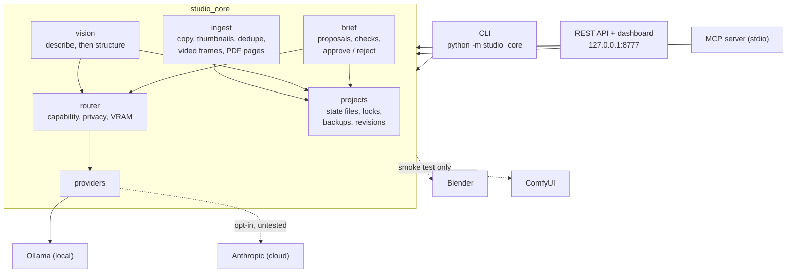

# Architectural Studio Core

A local-first engine for turning architectural references (photos, sketches, video, PDFs) into a design brief, 2D plans, a 3D model and renders. One approved specification drives every output. Language models propose, deterministic code checks, and the user approves. Nothing is written into the project brief by a model.

Today the engine covers project storage, reference ingestion, local vision analysis, model routing, and design brief proposals, exposed through a CLI, a REST API with a read-only dashboard, and an MCP server. Plans, 3D generation and rendering are not built yet.

## Status

| Phase | Scope | Status |
|---|---|---|
| 1 Foundation | Project store, config, providers, router, ingest (image/video/PDF), two-step vision analysis, REST, MCP, CLI | Done |
| 2 Design brief proposals | Requirements text -> local reasoning model drafts rooms, areas, adjacency and 1-3 concepts -> deterministic checks -> user approves a concept into `design_brief.yaml` | Done. Live run: 14-room proposal for a 2-storey house in 57 s on qwen3:8b; checks flagged missing stairs and a 16% area overrun |
| 3 2D plans | Deterministic plan generator from the approved spec | Planned |
| 4 3D model | Spec-driven Blender model, GLB export | Planned |
| 5 Visualisation | Renders, ComfyUI enhancement, walkthrough video | Planned |
| 6 Orchestration | Multi-agent task graph with review gates | Planned |
| 7 Full UI | Web UI for briefs, plans, model viewer, approvals | Planned |

The dashboard at `http://127.0.0.1:8777/` is read-only and does not show proposals yet.

## Key principles

- **Single source of truth.** One approved spec (`design_brief.yaml`, later `model_spec.json`) drives plans, geometry and renders. Image and video AI may only decorate outputs whose geometry came from the spec.
- **Dimension provenance.** Every dimension is stored as `{value, provenance, note}` where provenance is `provided`, `measured`, `estimated` or `unknown`. Vision output can never be `provided` or `measured`. A number a proposal claims the user stated is checked against the requirements text and downgraded to `estimated` if it is not there.
- **Analysis never edits the brief.** Vision findings are evidence. They reach the brief only through an approved decision or an approved proposal.
- **Safe writes.** Every state write takes a single-writer lock, backs up the previous file to `backups/`, and bumps the revision recorded in `revision_history.json`.
- **Local-first privacy.** Cloud models are off by default. Your reference images stay on the machine.
- **Capability-based routing.** Models are chosen by what Ollama reports they can do (vision, JSON, embedding, thinking), not by name, then by configured preference and VRAM fit.
- **One model in VRAM at a time.** Local models are unloaded after each step so an 8 GB card never holds two.

## Architecture



Dashed arrows are optional or not yet wired into the pipeline.

## Requirements

- Windows or Linux. Tested on Windows 11 with an RTX 5060 Laptop GPU (8 GB VRAM).
- Python 3.10 or newer.
- [Ollama](https://ollama.com) running locally, with `llama3.2-vision`, `qwen2.5:7b` and `qwen3:8b` pulled.
- `ffmpeg` and `ffprobe` on PATH (video frame extraction).
- Poppler `pdftoppm` on PATH (PDF page extraction).
- Blender (optional for now; needed from Phase 4).

## Install and configure

```bash
pip install -r requirements.txt
```

```bash
ollama pull llama3.2-vision
```

```bash
ollama pull qwen2.5:7b
```

```bash
ollama pull qwen3:8b
```

Settings resolve in this order: built-in defaults in `studio_core/config.py`, then `config/studio.yaml`, then environment variables. The repository is meant to ship `config/studio.example.yaml`; copy it to `config/studio.yaml` (git-ignored) and set your own values, for example:

```yaml
blender:
  executable: <path-to-blender>
comfyui:
  base_url: http://127.0.0.1:8188
```

Every key is optional; the defaults work with a local Ollama on its standard port. Environment overrides: `STUDIO_CONFIG`, `STUDIO_PROJECTS_ROOT`, `BLENDER_EXE`, `COMFYUI_URL`, `OLLAMA_URL`, `STUDIO_ALLOW_CLOUD`.

Check that everything is found:

```bash
python -m studio_core status
```

## Quick start

**Easiest (Windows):** double-click `Start_Studio.bat`. It starts the server and opens the dashboard. Closing that window (or pressing Ctrl+C) stops the server and frees port 8777. If the port is already in use it says so instead of starting a second copy.

CLI walkthrough, run from the repository folder.

Create a project:

```bash
python -m studio_core new "Hill House"
```

Import references (images, video and PDF are supported):

```bash
python -m studio_core import hill-house <path-to-photo.jpg>
```

```bash
python -m studio_core import hill-house <path-to-walkthrough.mp4>
```

```bash
python -m studio_core import hill-house <path-to-plan.pdf>
```

Analyse them with the local vision model (about 1.5-2 minutes per image on an 8 GB GPU):

```bash
python -m studio_core analyse hill-house
```

Draft a design brief proposal from requirements text:

```bash
python -m studio_core propose hill-house --file examples/requirements_demo.txt
```

List proposals, then approve the concept you want (concept numbers start at 0):

```bash
python -m studio_core proposals hill-house
```

```bash
python -m studio_core approve hill-house P001 --concept 0
```

Run the deterministic project checks:

```bash
python -m studio_core validate hill-house
```

Results: `projects/hill-house/analysis/reference_analysis.md` and `analysis/REF###.json` for analysis, `proposals/P001.md` and `.json` for proposals. Videos become frames every 2 s (at most 24); PDFs become one image per page; each frame or page is analysed on its own.

## CLI reference

Run as `python -m studio_core <command>`.

| Command | Description |
|---|---|
| `status` | Probe GPU, Blender, ComfyUI and model providers |
| `projects` | List projects |
| `serve [--open]` | Start the REST API and dashboard on localhost; `--open` opens the browser |
| `route <task>` | Show which model a task would use (`vision`, `reasoning`, `coding`, `json`, `light`, `docs`, `embedding`) |
| `new <name>` | Create a project |
| `import <project> <files...> [--note]` | Import image, video or PDF references |
| `analyse <project> [--ref REF###] [--force]` | Run vision analysis on all unanalysed images, or one reference |
| `validate <project>` | Run deterministic project checks; exit code 1 if invalid |
| `propose <project> (--text TEXT \| --file FILE)` | Draft a design brief proposal from requirements |
| `proposals <project>` | List brief proposals with status |
| `approve <project> <proposal> [--concept N]` | Adopt a proposal and one concept into the brief (user action) |
| `reject <project> <proposal> [--reason]` | Reject a proposal |
| `decide <project> <decision> <approved\|rejected>` | Approve or reject a recorded decision (user action) |

## REST API

Start with `python -m studio_core serve`. It binds to `127.0.0.1:8777` only, has no authentication, and refuses to start on any non-localhost address. Interactive docs (Swagger) are at `/docs`.

| Method | Path | Purpose |
|---|---|---|
| GET | `/` | Read-only dashboard |
| GET | `/health` | Liveness check |
| GET | `/status` | GPU, Blender, ComfyUI and provider report |
| GET | `/route/{task}` | Model chosen for a task |
| GET | `/projects` | List projects |
| POST | `/projects` | Create a project |
| GET | `/projects/{slug}/state/{name}` | Read one state file |
| GET | `/projects/{slug}/files/{path}` | Read-only access to thumbnails, originals and analysis JSON only |
| POST | `/projects/{slug}/references` | Import a reference by local file path |
| POST | `/projects/{slug}/analyse` | Run vision analysis (one reference or all) |
| POST | `/projects/{slug}/decisions` | Record a decision (default status `proposed`) |
| POST | `/projects/{slug}/decisions/{did}` | Set a decision to approved or rejected |
| POST | `/projects/{slug}/proposals` | Draft a brief proposal from requirements text |
| GET | `/projects/{slug}/proposals` | List proposals |
| GET | `/projects/{slug}/proposals/{pid}` | Read one proposal |
| POST | `/projects/{slug}/proposals/{pid}/approve` | Adopt a proposal and concept into the brief |
| POST | `/projects/{slug}/proposals/{pid}/reject` | Reject a proposal |
| POST | `/projects/{slug}/validate` | Run deterministic project checks |

## MCP (Claude Code or any MCP client)

Run from the repository folder, because the server imports `studio_core` from the working directory:

```bash
claude mcp add architectural-studio -- python -m studio_core.mcp_server
```

The MCP server calls the Python layer directly; the REST service does not need to be running.

| Tool | Purpose |
|---|---|
| `studio_status` | GPU, Blender, ComfyUI and model provider report |
| `route_task` | Which model a task would use |
| `list_projects` | List projects |
| `create_project` | Create a project |
| `read_project_state` | Read one of the 7 state files |
| `import_reference` | Import an image, video or PDF |
| `analyse_references` | Run vision analysis on one reference or all |
| `propose_decision` | Record a decision as `proposed` |
| `propose_brief` | Draft a brief proposal from requirements text |
| `list_brief_proposals` | List proposals with status |
| `validate_project` | Run deterministic project checks |

Agents can propose but cannot approve. Approving a decision or a brief proposal is available only through the CLI and REST API, not as an MCP tool.

## Project folder layout

Projects live under `projects/` (git-ignored, since they hold your private reference images).

```
projects/<slug>/
  project.json  design_brief.yaml  model_spec.json  reference_manifest.json
  decisions.json  revision_history.json  artifacts.json
  references/{originals,thumbnails,frames}/
  analysis/   proposals/   plans/   blender/   renders/   videos/   output/
  backups/    logs/
```

`proposals/` is created the first time you run `propose`.

| State file | Holds |
|---|---|
| `project.json` | Name, units, status, revision |
| `design_brief.yaml` | Requirements, room schedule, site, preferences, approved decisions, open questions, assumptions |
| `model_spec.json` | Levels, grids, spaces, walls, slabs, roofs, openings, stairs, materials (filled by Phases 3-4) |
| `reference_manifest.json` | Every imported file with hash, thumbnail, near-duplicate flag and analysis link |
| `decisions.json` | Proposed, approved and rejected decisions |
| `revision_history.json` | Every write: revision, author, file, note |
| `artifacts.json` | Generated files and whether each is geometrically authoritative |

Proposal files `proposals/P###.json` and `.md` record the model used, the drafted rooms (with provenance), adjacency, concepts, the deterministic check warnings and the status (`proposed`, `approved` or `rejected`). The deterministic checks cover duplicate room names, unknown adjacencies, rooms with no connection, missing stairs on multi-floor buildings, rule-of-thumb minimum room areas (not building-code values), gross area against the target, and ground coverage against the plot.

## Model routing and privacy

The router keeps models that report the needed capability, rejects cloud models unless allowed, then ranks by the configured preference list, then by VRAM fit.

| Task | Default preference order |
|---|---|
| `vision` | `llama3.2-vision`, `llava` |
| `reasoning` | `anthropic/claude-opus-5-5` (cloud, skipped by default), `qwen3:8b`, `deepseek-r1:8b` |
| `coding` | `anthropic/claude-opus-5-5` (cloud, skipped by default), `qwen3-coder:30b`, `deepseek-coder:6.7b` |
| `json` | `qwen2.5:7b`, `qwen3:8b` |
| `light` | `llama3.2`, `qwen2.5:7b` |
| `docs` | `qwen2.5:7b`, `qwen3:8b` |
| `embedding` | `nomic-embed-text` |

Cloud is off by default (`privacy.allow_cloud: false`). Ollama `*-cloud` models proxy to ollama.com and count as cloud. To allow cloud, set `privacy.allow_cloud: true` (or `STUDIO_ALLOW_CLOUD=1`) and export `ANTHROPIC_API_KEY`. The Anthropic adapter is written but has not been tested against the live API. OpenAI and Gemini adapters do not exist yet. Override the routing table in `config/studio.yaml`.

## Hardware notes

Measured on an RTX 5060 Laptop GPU with 8 GB VRAM:

- **Two-step vision.** Asking a vision model to fill a JSON schema directly gave near-useless output (materials guessed, openings "not visible"). Instead, `llama3.2-vision` describes the image freely and `qwen2.5:7b` structures that text into the schema. On a test render this got render type, storeys, roof and style right and labelled the size estimate as `estimated`.
- **Speed.** About 1.5-2 minutes per image end to end.
- **VRAM.** `llama3.2-vision` is 7.4 GB on disk but about 12 GB loaded, so it spills partly into system RAM. The router currently judges fit by file size and notes this limit.
- **Context and output caps.** `num_ctx` is 8192 (Ollama's default 32k pushed models off the GPU) and `num_predict` is capped at 1200 because the vision model could otherwise loop for over ten minutes on some images. Images are resized to at most 1024 px.
- **Unloading.** Each step unloads its model (`keep_alive: 0`) so only one model is resident.
- **Quality ceiling.** Local vision is good for style, massing, roof form and storeys, and weak on materials and exact counts. A cloud vision model is the upgrade path if you accept sending images off the machine.

See [MODEL_INVENTORY.md](MODEL_INVENTORY.md) for the benchmark detail.

## Testing

```bash
python -m unittest discover tests -v
```

26 tests (17 for Phase 1, 9 for Phase 2). They use stdlib `unittest` and need no GPU, network or running models. Live model runs are separate manual validation.

## Roadmap

- **Phase 3, 2D plans:** deterministic plan generator from the approved room schedule and adjacency, with walls, openings, dimensions, area table and a spec validator.
- **Phase 4, 3D model:** `model_spec.json` to Blender geometry, GLB export, and a plan-versus-model consistency check.
- **Phase 5, visualisation:** lighting presets, camera generator, stills, ComfyUI workflows, and walkthrough video, with enhanced images flagged non-authoritative.
- **Phase 6, orchestration:** project director task graph, specialist agents, review gates.
- **Phase 7, full UI:** web UI for the brief editor, plan viewer, GLB viewer and approvals.

## Limitations and disclaimer

- Outputs are concept material, not construction drawings, and make no claim of building-code compliance.
- Dimensions taken from photos are estimates and are labelled as such.
- Pinterest URLs are not fetched; save the image and import the file.
- Brief proposals depend on a small local model: review the check warnings and assumptions before approving.
- The API has no authentication and is for single-user localhost use only.
- Phases 3-7 do not exist. A Blender massing script in `engines/blender/` is a smoke test and does not read the project spec.

## Documentation

| File | Contents |
|---|---|
| [IMPLEMENTATION_PLAN.md](IMPLEMENTATION_PLAN.md) | Architecture and phase plan |
| [MODEL_INVENTORY.md](MODEL_INVENTORY.md) | Models, capabilities, vision benchmark, routing defaults |
| [ENVIRONMENT_AUDIT.md](ENVIRONMENT_AUDIT.md) | Software and hardware found on the development machine |
| [EXISTING_COMPONENTS.md](EXISTING_COMPONENTS.md) | What was reused or replaced from the v0.1 scaffold |
| [REPORT.md](REPORT.md) | Phase 1 report: what was demonstrated and what was not |
| [CHANGELOG.md](CHANGELOG.md) | Version history |
| [SKILL.md](SKILL.md) | Claude Code skill instructions for driving the engine |

## License

No license chosen yet — all rights reserved until one is added.
